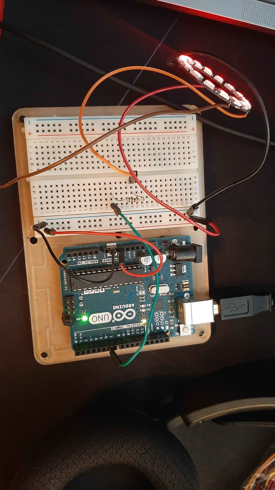

# NeoPixel Ring Breathe

A small Arduino sketch that makes a 16-LED NeoPixel ring pulse red in a slow "breathing" pattern. It was my first project driving addressable LEDs, written in January 2024.

## Hardware

- Arduino Uno
- 16-pixel WS2812 (NeoPixel) ring
- 560 Ω resistor in series on the data line
- Data in → pin 6 (through the resistor), 5 V → 5 V, GND → GND

## How it works

The sketch fills every pixel with red, then ramps the global brightness from 0 to 20 and back down in 50 ms steps. One full breath takes about 2 seconds, and brightness peaks at 20 out of 255.

## Running it

1. Install the **Adafruit NeoPixel** library from the Arduino Library Manager.
2. Open `ring_breathe/ring_breathe.ino` and upload it to the board.

## License

MIT. See [LICENSE](LICENSE).
